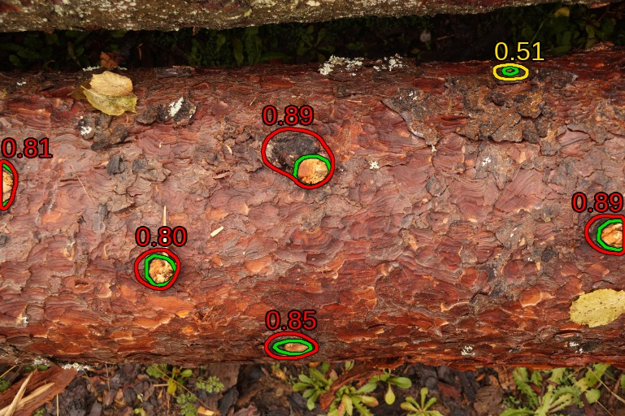

# Wood knot segmentation and matching on RGB images of logs

Code for the master's thesis *Detection of defects and quality
analysis of logs* (Matic Šutar, Faculty of Computer and Information Science, University of Ljubljana, 2026).

The goal is to find and count the knots on a bark-covered log from a set of RGB photographs taken around it. The problem is split into two steps:

1. Segmentation: predict a mask for every visible knot in each image. We compare three frameworks: nnU-Net, Ultralytics YOLO and a custom framework built on a DINOv3 ConvNeXt encoder.

2. Matching: project the knot masks of all images of a log onto a 3D reconstruction of the log and group them by spatial overlap, so that each physical knot is counted once.

## Results
Best configuration for each framework achieved the following scores:

| Framework | Pooled Dice | mAP50 |
|---|---|---|
| Custom (DINOv3 ConvNeXt-L + MA-Net) | 62.9% | 38.3% |
| Ultralytics YOLO (YOLO26m-seg) | 41.2% | 19.5% |
| nnU-Net (2D) | 30.5% | 10.2% |

*(Visualization of the best evaluated model on out-of-distribution sample. Green: annotations, yellow: low confidence predictions and red: high confidence predictions)*

On the annotated masks of one log, the matching makes no false matches and recovers 96.7% of the pairs of views showing the same knot. It counts 66 of 67 actual knots.

## Dataset
 
**WoodKnots-600** is available on the Hugging Face Hub:\
[`Elercast/WoodKnots-600`](https://huggingface.co/datasets/Elercast/WoodKnots-600)\
and Zenodo\

The dataset consists of 600 RGB images of 15 bark-covered logs, 16–87 images per log with 1171 polygon annotations of knots in COCO format, annotated in CVAT. One log additionally includes identity annotations for some knots, used for multi-view matching.